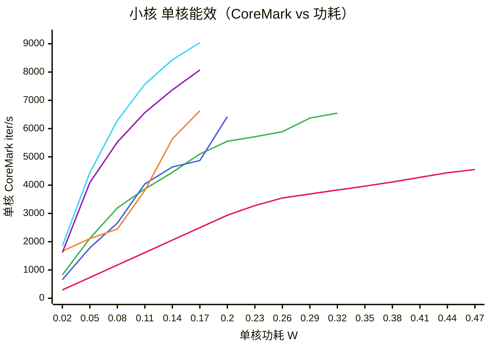
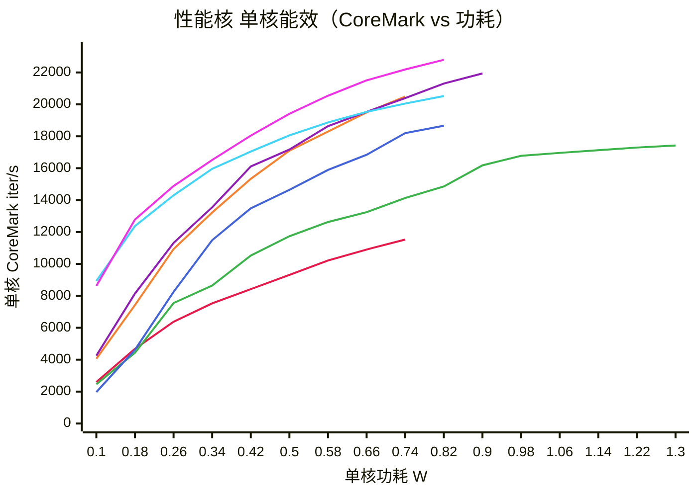
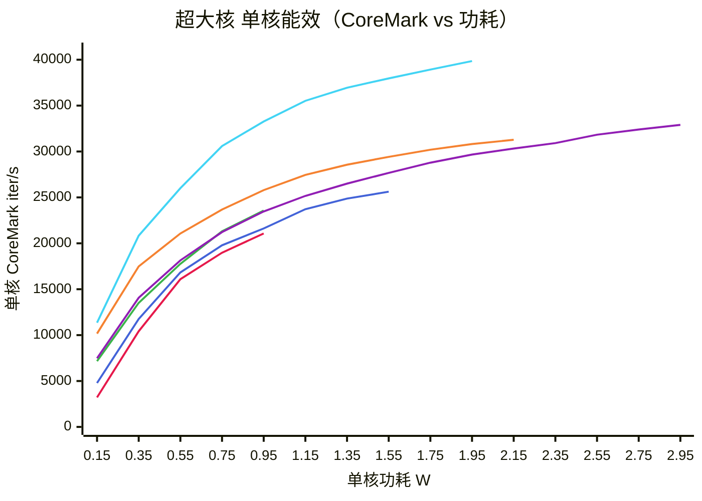
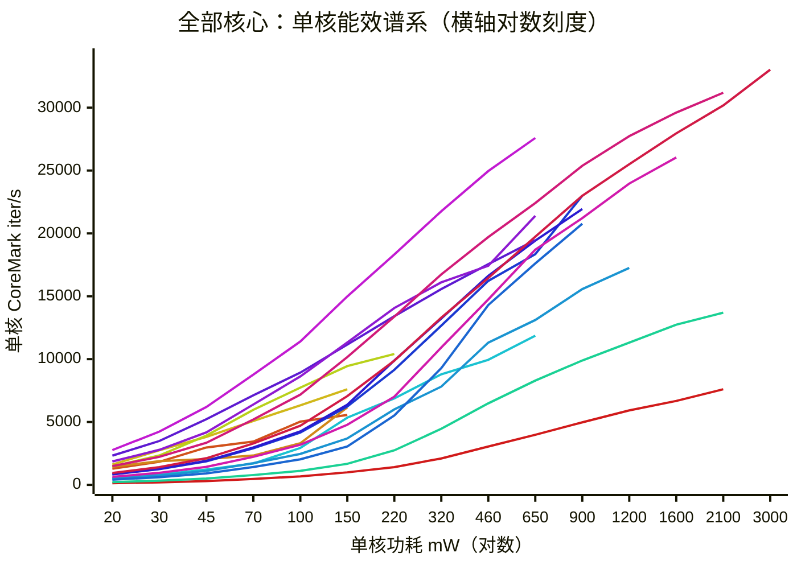

# 单核能效曲线：工艺 × 核心

> 横轴单核功耗，纵轴单核算力（CoreMark iter/s）。§1–§3 每条线 = 一种「制程 + 微架构」，按小核 / 性能核 / 超大核分三张；**§7 把它们收敛成一张全核总览**，17 条线各代表一种微架构。
> 数据来自本仓库 39 台真机的 `freqbench` 实测（非理论 DPC 推算），逐档取点。
> `xychart` 的图例有上限：mermaid 12.2 实测，**11 项线还有图例，12 项起整个图例不画**。§1–§3 只有 6–7 条线，图例由 mermaid 自己给；§7 有 17 条线、超出上限，所以那张图下面另附色球。GitHub 的 mermaid 版本较旧，可能不渲染 `xychart`，此时直接看 §5 与 §7.4 的数据表。

## 0. 读图须知

| 项 | 口径 |
| --- | --- |
| 横轴 | 单核功耗 = 簇功耗 ÷ 簇核数。簇功耗 = `n×active − (n−1)×净idle`，再做整机基线与漏电校正 |
| 口径 | 未标 `[O]` 的线走**整机燃料计差分**（先减整机 idle 基线，残差含板卡/供电损耗）；标 `[O]` 的走 **PMIC ODPM 逐轨净功率**（只算 CPU 轨）。两者横轴系统性差 20–40%，**只能同口径比、不能跨口径比横向位置**；纵轴（CoreMark）不受影响，可跨口径比 |
| 纵轴 | 单核 CoreMark iter/s，全部是「单核跑 CoreMark、其余核 idle」的实测，跨 SoC 同一负载、可直接比 |
| 端点 | 左端点 = 该核最低频实测档；右端点 = 顶频档 |
| 左端外推 | 低于最低频的段按 (0,0)→首点 线性补齐，仅为视觉连续；低频段真实 IPC 更高，外推值偏保守 |
| 右端终止 | 曲线在某功耗点断掉 = 该核已到顶频，单核功耗不可能再增长，**该线不是数据缺失，也不是性能归零** |
| 全部单核 | 每条线都是单核数据，簇功耗已按核数摊分 |

工艺标注带代工厂，这一列不是装饰：

- 台积电：`28nmLP`、`7nmN7`、`7nmN7P`、`5nmN5`、`4nmN4`、`4nmN4P`、`3nmN3E`
- 三星：`14nmLPP`、`10nmLPP`、`5nmSF5`、`4nmSF4`、`4nmSF4P`

必须分厂的原因：`sm8350`（骁龙 888）是**三星 5nm** 而非台积电 N5，`zuma`/`zumapro`（Tensor G3/G4）是**三星 4nm** 而非 N4/N4P，`lga`（Tensor G5）才是台积电 N3E。标错代工厂会把「换厂」误读成「架构进步」——比如同一个 X4 核，Tensor G4 用三星 SF4P、Tensor G5 用台积电 N3E，同频功耗差近一半，这跟 ARM 无关。

## 1. 小核：架构决定斜率，代工厂决定曲线落在哪

> 色标（按绘制顺序）：● 28nmLP+A53 ｜ ● 14nmLPP+A53 ｜ ● 10nmLPP+A55 ｜ ● 7nmN7+A55 ｜ ● 4nmSF4+A510 [O] ｜ ● 4nmSF4P+A520 [O]

- **28nm→14nm 同架构 A53**：顶频算力 4552 → 6547（+44%），几乎全部来自频率（1.4→2.0GHz），单位频率算力都是 3.25 CK/MHz。换节点在这里只买到「能跑更高频」。
- **10nm 三星 A55 → 7nm 台积电 A55**：CK/MHz 完全一样（3.71），曲线整体左移——0.17W 处台积电版 6630 vs 三星版 4871。这一段同时跨两代节点又换厂，不能全记在「换厂」账上，但方向明确。
- **A55→A510/A520**：CK/MHz 3.71 → 4.74/4.69（+27%），这是纯架构增益，与口径无关。但 0.1W 处 A510 6566、A520 7569 对比 A55 的 4043 **不能直接相减**——前者是 `[O]` 口径（只计 CPU 轨），横轴系统性偏左。
- A520 与 A510 几乎重合（顶频 9138 vs 8071），三星 SF4P 相对 SF4 在小核上没有可见增益。

## 2. 性能核：三星 5nm/4nm 两代几乎原地踏步

> 色标（按绘制顺序）：● 14nmLPP+A73 ｜ ● 10nmLPP+A75 ｜ ● 7nmN7+A76 ｜ ● 7nmN7P+A77 ｜ ● 5nmSF5+A78 ｜ ● 4nmSF4+A715 [O] ｜ ● 4nmSF4P+A720 [O]

- 0.5W 处（同为燃料计口径）：A73 9316 → A76 14644 → A77 17095 → A78 17169。再往后的 A715/A720 是 `[O]` 口径，18055/19411 不能直接接在这一串后面。
- 只看纵轴（不受口径影响）：A73 5.23 → A75 6.22 → A76 7.79 → A77 8.47 → A78 9.10，然后 **A715 回落到 8.67、A720 才追回 8.88**。A78 之后同频 IPC 基本停在 8.7–9.1，A7xx 两代是小改。
- 10nm A75 靠堆频率（2.8GHz）拿到 17425 的顶频算力，代价是 1.28W——能效曲线明显右移，典型的「用功耗换算力」。
- **A78（三星 SF5）→ A715（三星 SF4）**：代号升了一代、同频算力反而降 5%，能效也没有台阶。三星这两代 5nm/4nm 对中核几乎没有贡献；同期台积电 N7→N7P（A76→A77）是同频算力 +9%。

## 3. 超大核：换厂比换代更有效

> 色标（按绘制顺序）：● 7nmN7+A76 ｜ ● 7nmN7P+A77 ｜ ● 5nmSF5+X1 ｜ ● 4nmSF4+X3 [O] ｜ ● 4nmSF4P+X4 [O] ｜ ● 3nmN3E+X4 [O]

- 0.95W 处：燃料计口径 A76 21073 / A77 23563 / X1 21620；`[O]` 口径 X3 25794 / X4 23470 / N3E-X4 33270。前后两段之间隔着一层口径差，不要连成一条「代际曲线」。
- 本图的 A76/A77 是**单核高频版**（sm8150/sm8250 的 prime 核，2.84GHz）；§2 里同名两条是簇内 3 核版（2.42GHz），同架构、同 CK/MHz，只是顶频不同。
- **X4(SF4P) 在 1.15W 反低于 X3(SF4)**（25164 vs 27456）。同为三星 4nm、同为 `[O]` 口径，新一代架构反而更费电——SF4P 相对 SF4 没有实质改善。
- **台积电 N3E 的 X4 是唯一一条整体左移的曲线**：0.95W 就到 33270，比同核的三星 SF4P 版高 42%。同一个 X4、隔一代节点，换厂带来的增益大于 ARM 一代架构升级。

## 4. 换算：纵轴能换，横轴不能

三种算力单位在本仓库同时存在：CoreMark 分（freqbench 实测）、`capacity-dmips-mhz × f`（DT 推算，单位写作 Mdmips）、第三方 SPEC 曲线（sm8650/sm8750 的功耗来源）。是否能合并成一张图，取决于「同一核心在两套表里是否给出同一个纵轴」。

**同核型跨 SoC 的实测 CK/MHz（顶频点）：**

| 核型 | CK/MHz | 出现在 | 离散度 |
| --- | ---: | --- | ---: |
| A53 | 3.25 | msm8917(28nm TSMC) / msm8953(14nm SS) | 0% |
| A55 | 3.71 | sdm845(10nm SS) / sm8150(7nm TSMC) / sm8350(5nm SS) | 0% |
| A73 | 5.23 | sdm660(14nm SS) / msm8998(10nm SS) | 0% |
| X1 | 9.29 / 9.30 | sm8350(5nm SS) / gs201(5nm SS) | 0.1% |
| A510 | 4.74 | zuma(SF4) | — |
| A715 | 8.67 | zuma(SF4) | — |
| A720 | 8.88 | zumapro(SF4P) | — |
| X3 | 10.73 | zuma(SF4) | — |
| X4 | 10.66 / 10.67 | zumapro(SF4P) / lga(N3E) | 0.1% |

结论很干净：**CK/MHz 只由微架构决定，制程完全不影响纵轴**。所以任何一颗核，只要在别的 SoC 上有实测算力，就能给它的 DMIPS 表做锚点换算——sm8550 的 A510/A715/X3 就是这么算的：

| sm8550 核 | 锚点（实测 CK/MHz） | 顶频 | 换算算力 | 原 DMIPS 表读数 | CK per Mdmips |
| --- | --- | ---: | ---: | ---: | ---: |
| A510 | 4.74（zuma A510） | 2.02 GHz | ≈ 9556 | 657 Mdmips | 14.5 |
| A715 | 8.67（zuma A715） | 2.80 GHz | ≈ 24302 | 1943 Mdmips | 12.5 |
| A710 | 8.67（借用 A715，同簇） | 2.80 GHz | ≈ 24302 | 1943 Mdmips | 12.5 |
| X3 | 10.73（zuma X3） | 3.19 GHz | ≈ 34196 | 3264 Mdmips | 10.2 |

**但横轴换不了。** sm8550 的功耗是 `Cx·f·V²` 推理值（纯动态项），主图是燃料计差分的整机净功耗（含板卡与漏电），两者口径不同；而且上表最后一列 `CK per Mdmips` 从 10.2 漂到 14.5，说明 `capacity-dmips-mhz` 只是 SoC 内部的相对权重，不是绝对 DMIPS/MHz，跨表做线性换算会差 40%。

所以处理方式是：

| 数据 | 处理 | 原因 |
| --- | --- | --- |
| 36 台 freqbench 实测 SoC | 进主图（§1–§3） | 同负载、同测量链路，纵轴横轴都可比 |
| sm8550（DMIPS 表 + 推理功耗） | 只做锚点换算，不进图 | 算力可锚定，功耗口径不可换算 |
| sm8650（capacity + 整机差功耗） | 不进图 | X4/A720/A520 的算力可锚定 zumapro，但功耗是「整机差」含板卡，混入会整体右移 |
| sm8750（Oryon，第三方曲线） | 不进图 | Oryon 无同型实测，找不到锚点；容量 762/1024 只是簇间比例 |

## 5. 数据表

| 线 | SoC | 核数 | 顶频 MHz | 顶频算力 | CK/MHz | 功耗范围 W | 峰值能效 CK/W |
| --- | --- | ---: | ---: | ---: | ---: | --- | ---: |
| 28nmLP+A53 | msm8917 | 4 | 1401 | 4552 | 3.25 | 0.21–0.46 | 14.7k |
| 14nmLPP+A53 | msm8953 | 8 | 2016 | 6547 | 3.25 | 0.05–0.31 | 41.2k |
| 10nmLPP+A55 | sdm845 | 4 | 1766 | 6558 | 3.71 | 0.05–0.21 | 42.9k |
| 7nmN7+A55 | sm8150 | 4 | 1786 | 6630 | 3.71 | 0.01–0.16 | 110k\* |
| 4nmSF4+A510 [O] | zuma | 4 | 1704 | 8071 | 4.74 | 0.02–0.17 | 92.6k |
| 4nmSF4P+A520 [O] | zumapro | 4 | 1950 | 9138 | 4.69 | 0.04–0.18 | 92.4k |
| 14nmLPP+A73 | sdm660 | 4 | 2208 | 11551 | 5.23 | 0.22–0.74 | 26.0k |
| 10nmLPP+A75 | sdm845 | 4 | 2803 | 17425 | 6.22 | 0.21–1.28 | 29.5k |
| 7nmN7+A76 | sm8150 | 3 | 2419 | 18835 | 7.79 | 0.14–0.85 | 34.0k |
| 7nmN7P+A77 | sm8250 | 3 | 2419 | 20487 | 8.47 | 0.15–0.73 | 42.1k |
| 5nmSF5+A78 | sm8350 | 3 | 2419 | 22007 | 9.10 | 0.15–0.91 | 45.3k |
| 4nmSF4+A715 [O] | zuma | 4 | 2367 | 20520 | 8.67 | 0.03–0.81 | 117k |
| 4nmSF4P+A720 [O] | zumapro | 3 | 2600 | 23094 | 8.88 | 0.03–0.86 | 93.0k |
| 7nmN7+A76 | sm8150 | 1 | 2842 | 22147 | 7.79 | 0.16–1.09 | 31.5k |
| 7nmN7P+A77 | sm8250 | 1 | 2842 | 23953 | 8.43 | 0.17–0.98 | 42.7k |
| 5nmSF5+X1 | sm8350 | 1 | 2842 | 26390 | 9.29 | 0.25–1.64 | 34.3k |
| 4nmSF4+X3 [O] | zuma | 1 | 2914 | 31273 | 10.73 | 0.07–2.14 | 74.3k |
| 4nmSF4P+X4 [O] | zumapro | 1 | 3105 | 33092 | 10.66 | 0.16–3.03 | 47.1k |
| 3nmN3E+X4 [O] | lga | 1 | 3782 | 40339 | 10.67 | 0.08–2.05 | 77.9k |

\* 峰值能效取该线最低功耗点，受漏电校正噪声影响大（sm8150 的 A55 最低档只剩 10 mW，分母接近 0），只用于横向排序参考，不要当绝对值。

**等功耗切片（按口径分成两张，跨表不可比）：**

整机燃料计口径（`msm8917`/`msm8953`/`sdm660`/`sdm845`/`sm8150`/`sm8250`/`sm8350`）：

| 功耗 | A53 28nm | A55 10nm | A73 14nm | A76 N7 | A77 N7P | A78 SF5 | X1 SF5 |
| ---: | ---: | ---: | ---: | ---: | ---: | ---: | ---: |
| 0.14 W | — | 4643 | — | — | — | — | — |
| 0.50 W | — | — | 9316 | 14644 | 17095 | 17169 | — |
| 0.95 W | — | — | — | 21073 | 23563 | — | 21620 |

PMIC ODPM 口径（`zuma`/`zumapro`/`lga`）：

| 功耗 | A510 SF4 | A520 SF4P | A715 SF4 | A720 SF4P | X3 SF4 | X4 SF4P | X4 N3E |
| ---: | ---: | ---: | ---: | ---: | ---: | ---: | ---: |
| 0.14 W | 7369 | 8432 | — | — | — | — | — |
| 0.50 W | — | — | 18055 | 19411 | — | — | — |
| 0.95 W | — | — | — | — | 25794 | 23470 | 33270 |

（— = 该核到不了这个功耗点。）

## 6. 口径与已知偏差

1. **两种功耗口径混在图里**。36 台设备中 `gs201`/`lga`/`zuma`/`zumapro` 用 PMIC ODPM 逐轨净功率，其余用整机燃料计差分；后者把板卡与供电损耗的残差算进了 CPU 功耗，横轴系统性偏高 20–40%。图上用 `[O]` 标出 ODPM 的线，跨口径只能比纵轴与曲线形状，不能比横向位置——A715 看起来「比 A78 省电一大截」，主因就是口径。
2. **同口径内仍有设备差异**。X4(SF4P) 在 1.15W 低于 X3(SF4)（25164 vs 27456），两条同为 `[O]` 口径，差异来自设备与批次。同机曲线形状、差距 >30% 的排序才可信。
3. **漏电校正对低功耗档不友好**。`n×active − (n−1)×idle` 在两档接近时会放大噪声，个别点出现 <20 mW 的单核功耗（sm8150 A55 最低档 10 mW）。这些点不参与结论。
4. **顶频点是最不可靠的点**。升压后瞬时功耗受 DVFS 收敛影响，且顶频档往往只有 1–2 个采样。曲线右端可比性弱于中段。
5. **sm8650/sm8750 有意缺席**。前者算力可锚定但功耗是整机差；后者 Oryon 无同型实测。宁可不画，也不混口径。
6. **数据来源**：`freqbench/results/<soc>/{main,second}/results.json`（原始）→ `devimpbin/batch_ingest.py` 折算 → `mdocs/<soc>/<soc>-freq-power.md` §3。sm8550 的 DMIPS 表来自 `mdocs/sm8550/sm8550-freq-power.md`（Odin2 电压 + Cx 推理）。
7. **复现**：本文所有数组由 §3 表按「簇功耗 ÷ 核数」「簇算力 ÷ 核数」重新采样到统一功耗网格，未做平滑或拟合；`CK/MHz` = 顶频算力 ÷ 顶频 GHz。

## 7. 全核总览：17 条线装下 36 台机器的所有核型

§1–§3 是按簇分层的图，一层一张，为的是看清同一层内部的工艺差异。这一张反过来：**44 台真机的数据（39 台完成折算）、86 个簇、34 个「核型 × 工艺」组合，收敛成 17 条微架构曲线，全部挤进一个坐标系**。这里每条线 = 一种微架构（不是制程 × 微架构），取该核型数据最全的一次实测；工艺的影响回到 §1–§3 看。

> **看图先看图下的色球。** 17 条线超过了 mermaid 的图例上限（11 项），所以这张图**没有自动图例**——哪条线是 X1、哪条是 X3，只能靠下面那六行色球对颜色。要按名字找线，直接看 §7.5 的落位表。

> ● A15（exynos5250 / 32nm） ｜ ● A53（msm8998 / 10nmLPE） ｜ ● A55（sm8150 / 7nmN7）
> ● A510（zuma / 4nmSF4） ｜ ● A520（lga / 3nmN3E） ｜ ● Kryo（msm8996 / 14nmLPP）
> ● A73（msm8998 / 10nmLPE） ｜ ● A75（sdm845 / 10nmLPP） ｜ ● A76（sm8150 / 7nmN7）
> ● A77（sm8250 / 7nmN7P） ｜ ● A78（sm8350 / 5nmSF5） ｜ ● A715（zuma / 4nmSF4）
> ● A720（zumapro / 4nmSF4P） ｜ ● A725（lga / 3nmN3E） ｜ ● X1（sm8350 / 5nmSF5）
> ● X3（zuma / 4nmSF4） ｜ ● X4（zumapro / 4nmSF4P）

### 7.1 漏斗：44 → 39 → 86 → 78 → 34 → 17

| 层 | 数量 | 处理 |
| --- | --- | --- |
| 有 `results.json` 的真机 | 44&nbsp;台 | `freqbench/results/`(40) + `freqbench_tensor/results/`(lga 等) |
| 完成功耗折算 | 39&nbsp;台 | 有 `mdocs/<soc>/<soc>-freq-power.md`；未折算的 5 台见下 |
| 簇块 | 86&nbsp;个 | 每台 1–3 个簇 |
| 可用簇块 | 78&nbsp;块 | 剔除 `sm8550`（算力列是 `capacity × f` 推算的 Mdmips，非实测 CK）、`sm8650`（功耗是整机差）、`sm8750`（Oryon 无算力列），共 8 块 |
| 核型 × 工艺 | 34&nbsp;组 | 同组合多台合并，取频率档最全的一台（明细见 §7.4） |
| 核型 | 17&nbsp;条 | 本图的 17 条线 |

**没有完成折算的 5 台**，逐台核过原始 `results.json`，都不是漏算：

| SoC | 商用名 | 卡在哪 |
| --- | --- | --- |
| `sm8250ac` | 骁龙 865+ | 数据完整（有 `housekeeping`、3 簇、17 档），只是还没跑 `batch_ingest.py`。它的组合 `A77 + 7nmN7P` 已被 `sm8250` 覆盖，补进来只增台数、不增线 |
| `gs101` | Tensor G1 | 走 tensor 分支，无 `housekeeping`，得按 ODPM 口径另算；组合（X1/A78/A55 + 5nm 三星）已被 `gs201` 覆盖 |
| `sm7225` | 骁龙 750G | 原始 `power_samples` 全是**负值**（-6 ~ -108 mW），折算不出正功耗。它的 `A77 + 8nmLPP` 本可以新增一条线，可惜数据坏了 |
| `mt6768` | Helio G70 | 满频簇功耗只有 2.6 mW 量级，原始读数被单位缩放过 |
| `t8103` | Apple M1 | 燃料计读数恒为 0（`housekeeping.power_mean == 0.0`），量不到动态功耗 |

所以「就这么点」的答案是：**17 条线背后是 36 台可用真机、78 张实测表**。另外 18 台没有消失——`sm7150`/`sm7150ab`/`sm7150ac` 这类同工艺同核型的改款、`sdm670`/`sdm710`/`sdm712` 三兄弟、`sm6150`/`sm6150ac` 两代 675/678，都并进了同一条线。合并不是在偷懒，是因为**它们的差异本来就小于测量噪声**：`A55` 六条线（11nm 三星到 5nm 三星，跨三个节点）的 CK/MHz 全部是 3.71，`A76` 四条线全部 7.78–7.79，`X4` 两条跨台积电/三星两家厂也全是 10.66–10.67。同核型在纵轴上没有区别，这是 §4 那条结论在全量数据上的再次验证。

### 7.2 三条读图规则

1. **横轴是对数刻度，但它在 mermaid 里是类目轴**。`xychart` 的 x 轴按类目等距排布，把类目值取成等比数列（20 → 3000 mW，每格约 ×1.34），视觉上就是 `log10` 轴。必须这么做：小核单核 20–490 mW、超大核 1.6–3.0 W，线性轴会把 5 条小核线全挤进左边 16% 的宽度。
2. **左端 20–45 mW 那几十毫瓦是外推**。低于该核最低实测频的段按 (0,0)→首点补齐，只为视觉连续，不是实测。`X1` 实测起点在 246 mW，它左边七格都是外推；`A53`/`A55` 这类小核实测起点就在 13–20 mW，第一格基本是真值。
3. **右端断裂 = 该核到顶频了**。终止格取「最后一个 ≤ 顶频功耗的刻度」，所以与真实顶频档最多差一格（相邻刻度约 1.3 倍），排序不受影响。要精确顶频值看 §7.4 的表——注意表里 `X4 3nmN3E`（lga）的 40339 比本图纵轴上限还高，那条曲线在 §3，本图的 X4 画的是 `zumapro` 那条（33092）。

颜色按微架构代际排：红（A15）→ 橙黄（A53/A55/A510/A520）→ 青（Kryo/A73）→ 蓝（A75–A78）→ 紫（A715–A725）→ 品红（X1/X3/X4）。

### 7.3 谱系上能读到的四件事

**一、2012 年的 A15 是整张图的最低点。** `exynos5250` 单核 2287 mW 只换 7826 CK（3.4 CK/mW）；同样落在 2.1 W 附近，`X3` 是 31185 CK、`X4` 是 30178 CK——**同功耗下算力差约 4 倍**。这是 32nm 到 3nm 十二年攒下来的全部进步，也是这张图最有说服力的一条对角线。

**二、A55 的六条线叠成一条，横向却拉开 2.4 倍。** 六种工艺（11nm/10nm/8nm/7nm/7nmP/5nm）纵轴全是 3.71 CK/MHz，顶频算力 6345–6701 —— **架构把纵轴锁死，工艺只能决定它落在横轴哪里**。但横向那 143–339 mW 的 2.4 倍差距不能读成工艺收益，主因是设备与口径差异（§6 第 2 条），同一工艺的 `sm7150`/`sm7150ab`/`sm7150ac` 三台自己就能差 40%。

**三、大核与超大核在 1 W 附近重叠。** 同属三星 5nm 的 `sm8350`：`A78` 顶频 908 mW / 22007 CK，`X1` 顶频 1636 mW / 26390 CK——**X1 多花 80% 功耗换 20% 算力**。超大核从来不是能效选择，是延迟选择；图右上那三条品红线之所以陡，是因为它们横轴的每一格代表的绝对功耗更大。

**四、今天的小核已经压过 2016 年的中核。** `A520`（lga，3nm）顶频 231 mW / 10532 CK，`A73`（msm8998，10nm）顶频 844 mW / 12857 CK：**A520 用 27% 的功耗拿到 82% 的算力**，能效是后者的 3 倍。图左下角那簇橙线横向压过了 y=13000 以下的全部旧大核——这也是为什么现在的调度器敢把后台任务全丢给小核。

### 7.4 34 个「核型 × 工艺」组合明细

本图 17 条线的完整数据源。同一组合下有多台时取频率档最全的一台做代表，「台数」是该组合覆盖的真机数：

| 核型 | 工艺 | 厂 | 代表 SoC | 台数 | 档位 | 顶频单核 mW | 顶频单核 CK | CK/MHz |
| --- | --- | --- | --- | ---: | ---: | ---: | ---: | ---: |
| A15 | 32nm | 三星 | exynos5250 | 1 | 16 | 2287 | 7826 | 4.60 |
| A53 | 28nmLP | 台积电 | msm8940 | 2 | 6 | 444 | 4552 | 3.04 |
| A53 | 14nmLPP | 三星 | exynos7880 | 7 | 15 | 490 | 6069 | 3.24 |
| A53 | 12nmLPP | 三星 | sdm439 | 1 | 6 | 271 | 6547 | 3.25 |
| A53 | 11nmLPP | 三星 | sm6115 | 2 | 8 | 204 | 5846 | 3.24 |
| A53 | 10nmLPE | 三星 | msm8998 | 1 | 22 | 186 | 6158 | 3.24 |
| A55 | 11nmLPP | 三星 | sm6150 | 2 | 9 | 339 | 6345 | 3.71 |
| A55 | 10nmLPP | 三星 | sdm845 | 5 | 18 | 208 | 6558 | 3.71 |
| A55 | 8nmLPP | 三星 | sm7125 | 4 | 10 | 143 | 6701 | 3.71 |
| A55 | 7nmN7 | 台积电 | sm8150 | 3 | 18 | 161 | 6630 | 3.71 |
| A55 | 7nmN7P | 台积电 | sm8150ac | 2 | 18 | 224 | 6630 | 3.71 |
| A55 | 5nmSF5 | 三星 | sm8350 | 2 | 16 | 158 | 6699 | 3.71 |
| A510 | 4nmSF4 | 三星 | zuma | 1 | 10 | 170 | 8071 | 4.74 |
| A520 | 4nmSF4P | 三星 | zumapro | 1 | 10 | 175 | 9138 | 4.69 |
| A520 | 3nmN3E | 台积电 | lga | 1 | 20 | 231 | 10532 | 4.69 |
| Kryo | 14nmLPP | 三星 | msm8996 | 1 | 25 | 2270 | 14277 | 6.64 |
| A73 | 14nmLPP | 三星 | exynos7904 | 4 | 6 | 670 | 9473 | 5.36 |
| A73 | 11nmLPP | 三星 | sm6115 | 2 | 9 | 521 | 10539 | 5.23 |
| A73 | 10nmLPE | 三星 | msm8998 | 1 | 31 | 844 | 12857 | 5.23 |
| A73 | 10nmLPP | 三星 | exynos9611 | 1 | 15 | 1233 | 12448 | 5.38 |
| A75 | 10nmLPP | 三星 | sdm845 | 4 | 24 | 1283 | 17425 | 6.22 |
| A76 | 11nmLPP | 三星 | sm6150ac | 2 | 13 | 1197 | 17186 | 7.78 |
| A76 | 8nmLPP | 三星 | sm7150ac | 4 | 14 | 1062 | 17947 | 7.79 |
| A76 | 7nmN7 | 台积电 | sm8150 | 3 | 20 | 1092 | 22147 | 7.79 |
| A76 | 7nmN7P | 台积电 | sm8150ac | 1 | 21 | 1285 | 23039 | 7.79 |
| A77 | 7nmN7P | 台积电 | sm8250 | 1 | 20 | 984 | 23953 | 8.43 |
| A78 | 5nmSF5 | 三星 | sm8350 | 2 | 16 | 908 | 22007 | 9.10 |
| A715 | 4nmSF4 | 三星 | zuma | 1 | 15 | 812 | 20520 | 8.67 |
| A720 | 4nmSF4P | 三星 | zumapro | 1 | 17 | 860 | 23094 | 8.88 |
| A725 | 3nmN3E | 台积电 | lga | 1 | 22 | 680 | 27971 | 9.16 |
| X1 | 5nmSF5 | 三星 | sm8350 | 2 | 19 | 1636 | 26390 | 9.29 |
| X3 | 4nmSF4 | 三星 | zuma | 1 | 15 | 2135 | 31273 | 10.73 |
| X4 | 4nmSF4P | 三星 | zumapro | 1 | 18 | 3028 | 33092 | 10.66 |
| X4 | 3nmN3E | 台积电 | lga | 1 | 21 | 2054 | 40339 | 10.67 |

读这张表只需要看两列：**CK/MHz 由微架构决定**（同核型跨工艺、跨代工厂恒定，`A55` 全 3.71、`X4` 10.66/10.67），**顶频单核 mW 由工艺和电压曲线决定**（同核型能差 2 倍以上）。唯一一处走样是 `A53 28nmLP` 的 3.04，比其余四条 A53 的 3.24–3.25 低 6%——`msm8940` 的 CoreMark 读数偏低，属测量偏差，不影响排序。

### 7.5 36 台机器全部落位

上一张表只给了「台数」，这里给名字。查自己的机器：先在这张表里找到 SoC，再回 §7.4 看它的顶频数据。

| 核型 | 工艺 | 台数 | 覆盖的 SoC |
| --- | --- | ---: | --- |
| A15 | 32nm | 1 | exynos5250 |
| A53 | 28nmLP | 2 | msm8917, msm8940 |
| A53 | 14nmLPP | 7 | exynos7880, exynos7904, msm8953, sdm630, sdm632, sdm636, sdm660 |
| A53 | 12nmLPP | 1 | sdm439 |
| A53 | 11nmLPP | 2 | sm6115, sm6125 |
| A53 | 10nmLPE | 1 | msm8998 |
| A55 | 11nmLPP | 2 | sm6150, sm6150ac |
| A55 | 10nmLPP | 5 | exynos9611, sdm670, sdm710, sdm712, sdm845 |
| A55 | 8nmLPP | 4 | sm7125, sm7150, sm7150ab, sm7150ac |
| A55 | 7nmN7 | 3 | mt6853t, sm7250ab, sm8150 |
| A55 | 7nmN7P | 2 | sm8150ac, sm8250 |
| A55 | 5nmSF5 | 2 | gs201, sm8350 |
| A510 | 4nmSF4 | 1 | zuma |
| A520 | 4nmSF4P | 1 | zumapro |
| A520 | 3nmN3E | 1 | lga |
| Kryo | 14nmLPP | 1 | msm8996 |
| A73 | 14nmLPP | 4 | exynos7904, sdm632, sdm636, sdm660 |
| A73 | 11nmLPP | 2 | sm6115, sm6125 |
| A73 | 10nmLPE | 1 | msm8998 |
| A73 | 10nmLPP | 1 | exynos9611 |
| A75 | 10nmLPP | 4 | sdm670, sdm710, sdm712, sdm845 |
| A76 | 11nmLPP | 2 | sm6150, sm6150ac |
| A76 | 8nmLPP | 4 | sm7125, sm7150, sm7150ab, sm7150ac |
| A76 | 7nmN7 | 3 | mt6853t, sm7250ab, sm8150 |
| A76 | 7nmN7P | 1 | sm8150ac |
| A77 | 7nmN7P | 1 | sm8250 |
| A78 | 5nmSF5 | 2 | gs201, sm8350 |
| A715 | 4nmSF4 | 1 | zuma |
| A720 | 4nmSF4P | 1 | zumapro |
| A725 | 3nmN3E | 1 | lga |
| X1 | 5nmSF5 | 2 | gs201, sm8350 |
| X3 | 4nmSF4 | 1 | zuma |
| X4 | 4nmSF4P | 1 | zumapro |
| X4 | 3nmN3E | 1 | lga |

每一行是一组「核型 × 工艺」，同一台机器的 2–3 个簇分别落在不同行（`sm8150` 就同时出现在 `A55 7nmN7` 和 `A76 7nmN7`），所以「台数」列相加是 69 而不是 36；**按 SoC 去重后正好 36 台，一台不多、一台不少**。

### 7.6 没进图的核型：3 种有数据但画不出，5 种仓库里根本没有

先把 X2 说清楚：**这个仓库没有任何一颗 X2 的实测数据**。`freqbench/results/` 与 `freqbench_tensor/results/` 里没有 `sm8450`、没有天玑 9000（`mt6983`）、也没有 Exynos 2200；内核对 X2 的支持只体现在 `common/arch/arm64/boot/dts/exynos/exynos2200.dtsi` 这一份参考 DT 上。**X1、X3、X4 都在图上**（色球第 5、6 行），X2 是唯一缺席的那一代超大核。

| 核型 | 状态 | 卡在哪 |
| --- | --- | --- |
| `X2` | 仓库无数据 | 没有 sm8450 / 天玑 9000 / Exynos 2200 的采集，DT 里只有 exynos2200 参考板 |
| `A710` | 有数据，测不出单核 | 只在 `sm8550` 的 big 簇里与 A715 同簇同频（A715×2 + A710×2），实测只能得到簇合计；sm8550 本身因功耗是 `Cx·f·V²` 推理值、算力是 `capacity×f`，本来就不进图 |
| `Oryon` | 有数据，算不出纵轴 | `sm8750` 有 results，但那份 `freq-power.md` 没有算力列；Oryon 也没有可锚定的同型实测，无法反推 CK/MHz |
| `X925` | 仓库欠一代 | 没有 8 Elite Gen 2 / 天玑 9400 的采集 |
| `A35` `A57` `A72` | 仓库无实测 | DT 里有（A35 七处；A57/A72 只出现在 juno、alpine、amd 这些参考板与服务器 DT），但没采集过用它们的手机 |

内核 DT 字面上的 `arm,cortex-*` 共 19 种，加上用 Qualcomm 私有名写的 `A77`/`A725` 和自研 `Kryo`，这个仓库「认得」22 种核型；**实测覆盖 17 种，剩下 5 种连数据都没有**。图上 17 条线是「有实测 CoreMark + 可信功耗」的交集，不是「我知道的核型」的合集——缺的那几种画上去只能是编的。

顺带说一句：这一节和 §7.1 的差别是「合并」与「缺失」的区别。§7.1 那 18 台是**有数据、核型工艺重复**，合并进同一条线，数据没丢；这里说的是**根本没有数据**，两回事。
